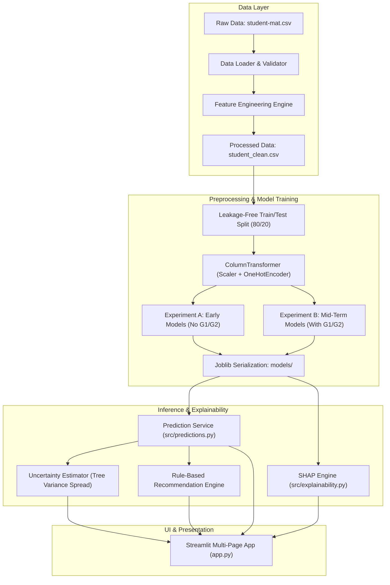

# System Architecture & Component Interaction

## Architecture Overview
The system follows a decoupled, three-tier architecture:
1. **Presentation & Application Layer**: Interactive Streamlit multi-page frontend.
2. **Business Logic & Inference Layer**: Scikit-Learn pipelines, SHAP explainers, and rule-based recommendation engine.
3. **Data & Persistence Layer**: File-based storage holding raw CSVs, processed datasets, and serialized Joblib model artifacts.

---

## Architecture Flow Diagram

---

## Component Breakdown
- `config/settings.py`: Centralized directory paths, random seed (42), and target thresholds.
- `src/data_loader.py`: Semicolon-delimited CSV reader, schema assertion, null/duplicate checker.
- `src/feature_engineering.py`: Computes derived educational features and binary at-risk targets.
- `src/preprocessing.py`: Implements `ColumnTransformer` with strict separation between Experiments A and B.
- `src/train_regression.py` & `src/train_classification.py`: Executes 5-fold cross-validation, fits models, and exports joblib artifacts.
- `src/explainability.py`: Manages SHAP TreeExplainer and LinearExplainer pipelines, generating summary and waterfall plots.
- `src/predictions.py`: Handles individual and batch CSV predictions, uncertainty bounds, and schema validation.
- `src/recommendations.py`: Multi-factor rule-based logic generating empathetic, non-judgmental remediation advice.
- `app.py`: Modern, responsive 9-page dashboard built with Streamlit and Plotly.
